# How to Use LSTM to Predict the Future Value of the Shanghai Composite Index

\tNote: This tutorial is a supplement to previous time series models, aimed at providing a simple example of predicting future data!
In most predictive tasks, visualizations of future data predictions are generally not required (only the model's fit to historical data is shown). This is because obtaining actual future data is challenging, making it difficult to evaluate the prediction fit. Therefore, a portion of the known dataset is partitioned into a test set to serve as the basis for visualizing the fit to future data. In real-world projects, however, predictions on future data may be necessary. This work will introduce how to use a trained model to predict future data!
Preface
● Environment Framework: Python 3.9, PyTorch 1.8 and above can be run.
● Usage: Paper requirements, graduation projects, project demanders.
● Code Guarantee: The code comments are detailed and ready to run.
1. Dataset Introduction and Preprocessing
1.1 Import the dataset
From the beginning of the year to October 25th, a total of 195 trading days data:
\t  
1.2 Data Set Production
Training set and test set are divided into 8:2 ratio, the sliding window is set to 7.
2. LSTM prediction model based on Pytorch
2.1 Define the LSTM prediction model
\t  
\t  
2.2 Set parameters and train the model
\tNote: Adjust parameters.
\tThe number of LSTM layers and the number of neurons per layer can be modified.
\tIncrease more epochs (note to prevent overfitting)
\tThe sliding window length can be changed (set the appropriate window length).
\t  
3. Model Evaluation and Visualization
3.1 Results Visualization
3.2 Model Evaluation
4. Forecasting future data
4.1 Prediction Strategy
\tStep 1: Load the trained model and historical data.
Step 2: Initialize the future prediction sequence and trading day time.
\t  
Step 3: Following the training input method, which involves predicting one step in the future using the last seven steps of historical data, use the final seven steps of historical data to predict the first day's data. Then update this seven-value window sequence by deleting the first data with each prediction and adding the predicted results as the last (assuming the predicted value is known, predicting the next step).
\t  
4.2 Visualization of Prediction Results
\tIndividual Prediction Results:
\t\tCombined with historical data visualization:
(1) Step-by-step prediction of the whole family set.
(2) Multi-step Prediction Family Kit
(3) Sparrow Optimization Algorithm - Innovation Predictive Model Full Set
(4) Secondary Decomposition - Innovative Model Prediction for the Full Family Set
Previously Featured Content:
From Beginner to Publication | The Most Comprehensive Collection of Time Series Forecasting
| Super-strong combination prediction model!
High Innovation | CEEMDAN + SSA-TCN-BiLSTM-Attention Predictive Model
| Based on TCN-SENet + BiGRU-GlobalAttention Parallel Prediction Model
Secondary Decomposition - Innovative Model Prediction for the Family Pack
| BiTCN-BiGRU-CrossAttention fusion spatiotemporal features high innovative prediction model
Parallel prediction model based on multi-level attention mechanism
| CEEMDAN-Transformer-BiLSTM Parallel + XGBoost Combination Prediction
Super Predictive Model | Full Family Kit of Regression Predictions Updated
Free Download | Time Series Common Datasets, Visualization Code
Innovation in Increase | Parallel Prediction Model Based on Informer-LSTM
Hotspot Innovation | Predictive Model Based on TCN, Transformer, GRU, CNN and KAN Networks
Free Download (II) | Wind Farm Velocity and Electrical Load Data Set
| Parallel Prediction Model Based on Informer + TCN-SENet
Strongest Update | Achieve Complete Mastery of Python Time Series Forecasting with One-Time Purchase
Ready-to-Use | Time Coding + LSTM + Global Attention
Half Day Introduction! Lithium Battery Remaining Lifespan Prediction (Python)
Fan Benefits | Added Seq2Seq Multi-Step Forecast Model
Hotspot Innovation | Parallel Prediction Model Based on KANConv-GRU
Blood Rush Points! | Parallel Prediction Model Based on Informer+BiGRU-GlobalAttention
Reject Information Leaks! VMD Rolling Decomposition + Informer-BiLSTM Parallel Forecast Model
Time Series Forecasting, Classification | Open Source Code Sharing for Graph Neural Networks (Part 1)
END

## Images

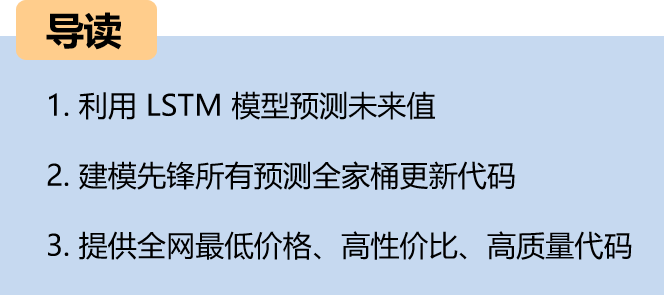

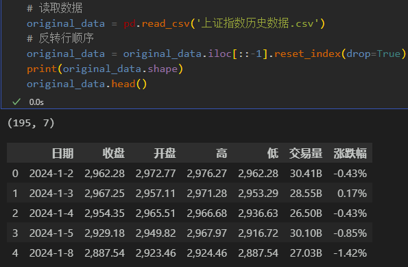
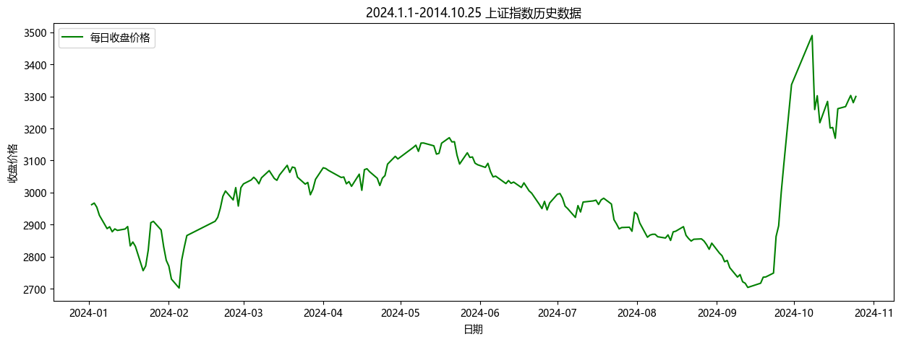
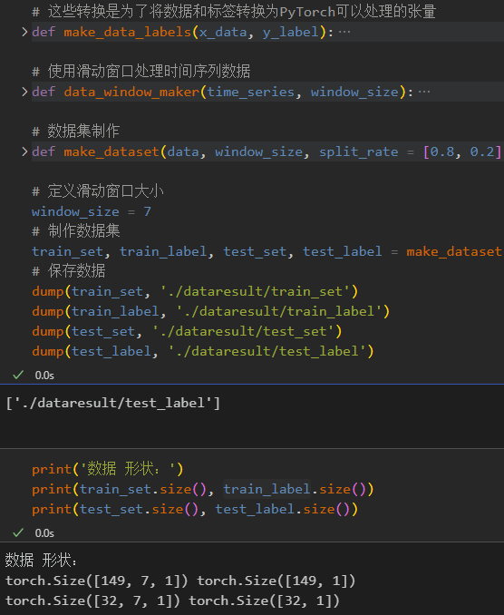
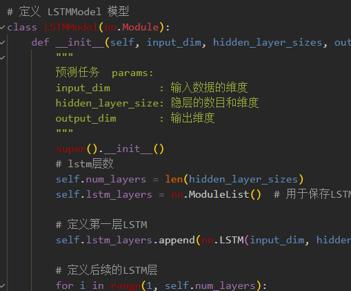
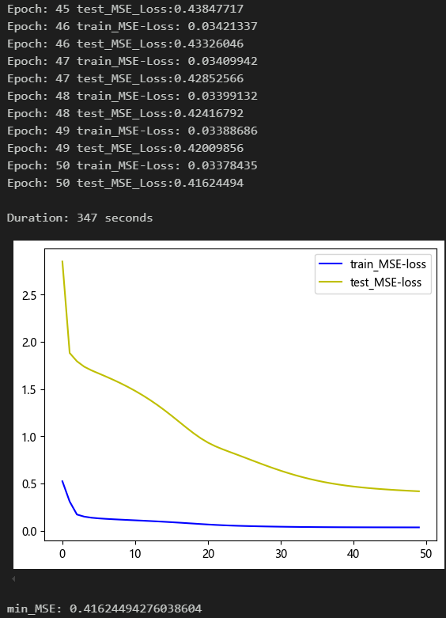
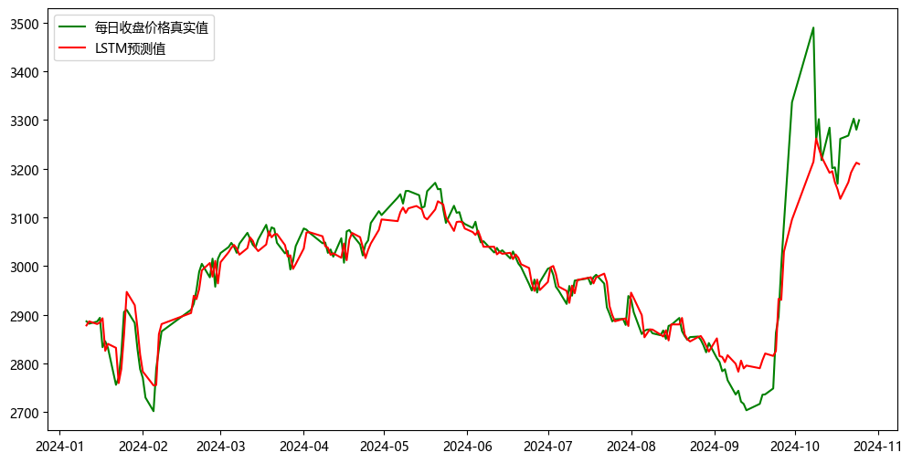
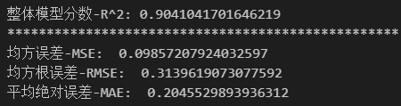
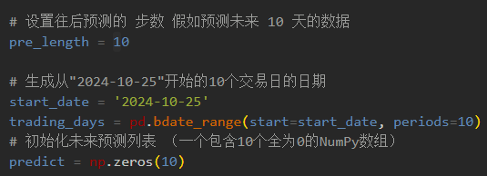
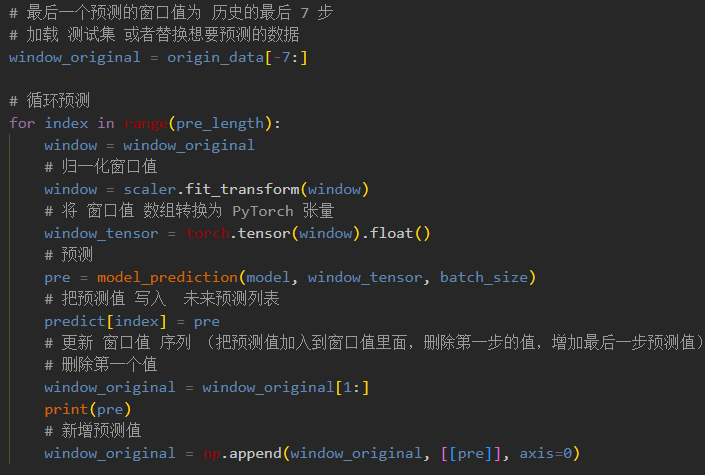
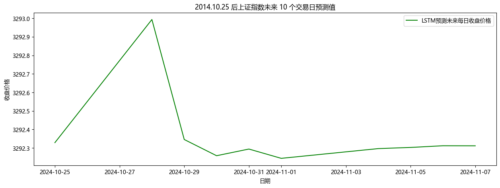
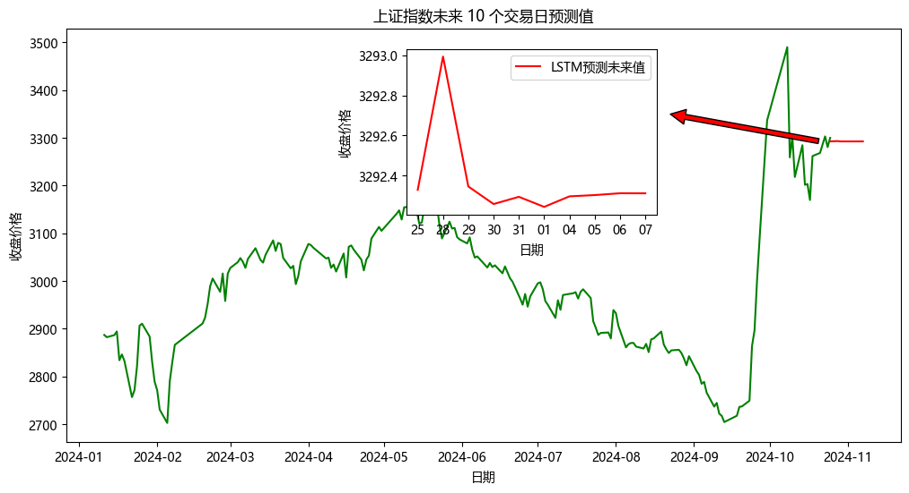
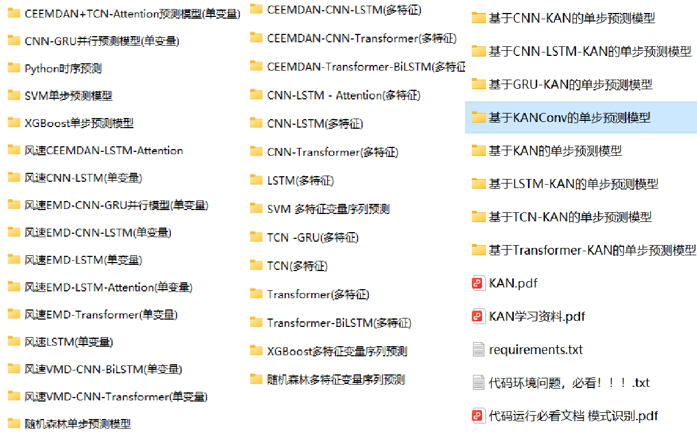
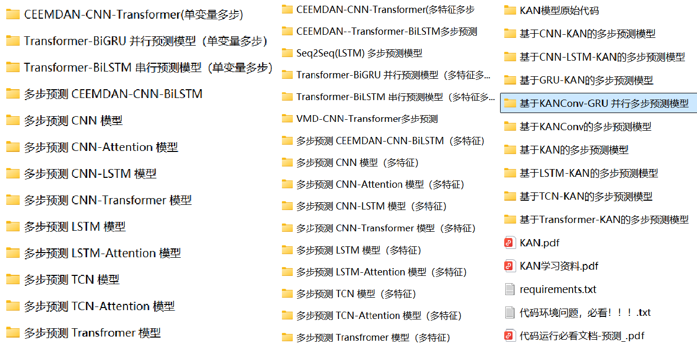
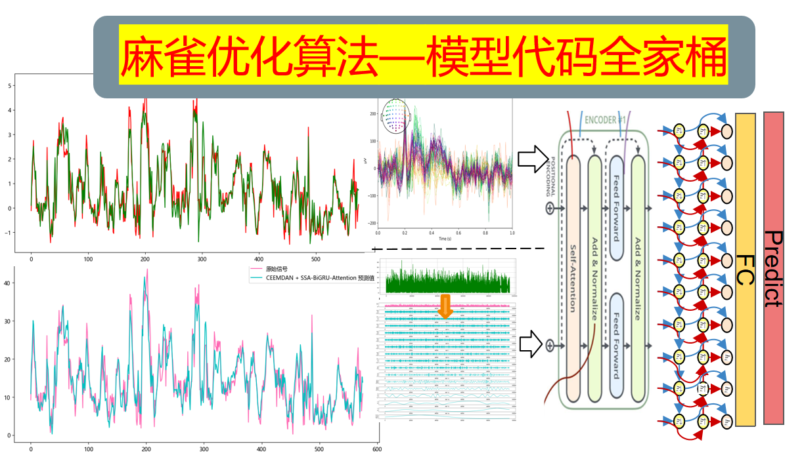

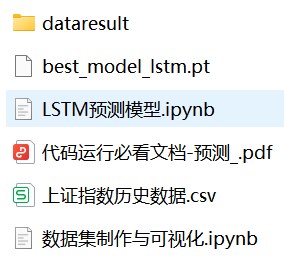

<!-- PAYMENT_BLOCK -->

## Get this dataset

- Payment link (Stripe): [Buy now](https://buy.stripe.com/3cs8yP7sY87d0vu9AB)
- Payment QR code: 

<!-- /PAYMENT_BLOCK -->
